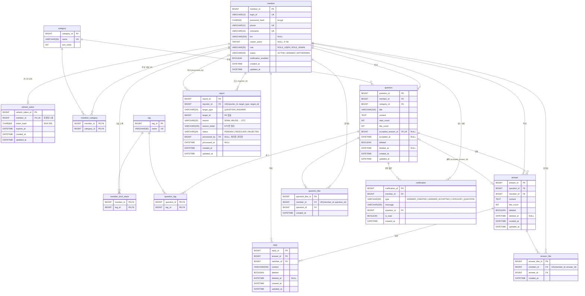

# ERD — Dev in

`backEnd/db/schema.sql` 기준이다. 컬럼 설명은 `docs/04-db.md`, 설계 근거는 `docs/03-db-open-questions.md`를 본다.
테이블을 바꾸면 이 문서도 함께 고친다.

## 다이어그램

## 테이블 요약

| 테이블 | 설명 | 주요 제약 |
|---|---|---|
| `member` | 회원 | `login_id`, `phone`, `nickname` 각각 UNIQUE |
| `refresh_token` | Refresh Token 해시 | 회원당 1개 (`member_id` UNIQUE), 회원 삭제 시 CASCADE |
| `category` | 질문 카테고리 | `name` UNIQUE |
| `tag` | 질문 태그·회원 기술 스택 공용 | `name` UNIQUE, seed로만 추가 |
| `member_category` | 회원 관심 카테고리 (N:M) | PK (`member_id`, `category_id`) |
| `member_tech_stack` | 회원 기술 스택 (N:M) | PK (`member_id`, `tag_id`) |
| `question` | 질문 | `accepted_answer_id` UNIQUE, 채택 여부와 `accepted_at`은 함께 NULL/NOT NULL |
| `question_tag` | 질문 태그 (N:M) | PK (`question_id`, `tag_id`) |
| `answer` | 답변 | |
| `reply` | 답변의 답글 | |
| `question_like` | 질문 좋아요 | UNIQUE (`member_id`, `question_id`) |
| `answer_like` | 답변 좋아요 | UNIQUE (`member_id`, `answer_id`) |
| `report` | 질문·답변 신고 | UNIQUE (`reporter_id`, `target_type`, `target_id`) |
| `notification` | 알림 | |

## 참고
- **삭제:** 질문·답변·답글은 `deleted`로 숨기고(soft delete), 회원은 `status`로 관리한다. 좋아요 취소만 행을 실제로 지운다.
- **채택:** `question.accepted_answer_id`가 `answer`를 가리킨다. UNIQUE라서 한 답변은 한 질문에서만 채택된다.
- **신고 대상:** `report.target_type` + `target_id`로 질문 또는 답변을 가리킨다. 대상이 두 테이블이라 FK를 두지 않고, 대상이 있는지는 Service에서 확인한다.
- **좋아요 수:** `question.like_count`, `answer.like_count`는 목록 정렬용 집계 컬럼이다. 좋아요 행을 추가·삭제할 때 함께 바꾼다.
- **답변 수:** 따로 저장하지 않고 삭제되지 않은 `answer`를 세서 구한다.
- **등급·뱃지·채택률:** 따로 저장하지 않는다(점수 컬럼 없음). 조회할 때 `answer`와 `question.accepted_answer_id`로 계산한다.
